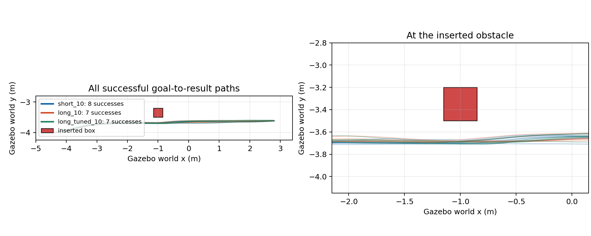

# M3-4 实验报告：近路径动态障碍下的前视距离

## 要回答的问题

同一辆阿克曼车、同一张地图、同一个突然出现的箱体下，局部控制器的前视距离会怎样影响到点成功率、耗时和路径形状？如果较差的一组把前视距离调回中间值，结果是否改善？

本实验比较 Regulated Pure Pursuit 的两套参数，**没有更换控制器插件**。全局规划器均为 Hybrid-A*。地图沿用 M3-2 的正式占据栅格，定位沿用 M3-3 的 AMCL。

## 场景与记录方法

车从 Gazebo 世界 `(-5,-4)` 朝东出生，预热并确认定位后，导航到地图 `(8.0,0.4,0°)`。目标接受 8 个仿真秒后，在世界 `(-1.0,-3.35)` 放入 `0.30 × 0.30 × 0.50 m` 的静止箱体。它靠近正常行驶带的北侧，进入代价地图安全区域，能够影响规划和碰撞预测；成功轨迹大多从箱体南侧通过。因此本文称它为**近路径动态障碍**，不称“封死走廊”。轨迹图可直观看到这个几何关系。

三组配置只在 `FollowPath.lookahead_dist` 上不同：短前视 `0.30 m`、长前视 `0.80 m`、长前视调优 `0.50 m`。目标速度均为 `0.18 m/s`，全局/局部代价地图膨胀半径均为 `0.15 m`，其余参数、目标和箱体不变。调优对象在前两组各 10 次完成后按成功率选择，未按某一次轨迹临时改场景。三份完整 YAML 和每组运行时参数读回均已保存。

每次启动独立 Gazebo、AMCL、Nav2。导航前让车行驶两段 `0.3 m`，分别建立实时定位变换和检验代价地图是否随车移动。若起跑前代价地图冻结，整次启动记录在 `attempts/` 并重启；只有目标已被接受的 `run_01` 到 `run_10` 进入每组的十次分母。三组的预检规则相同。每次记录 Gazebo 真值、里程计、指令、激光、全局路径及终点 `map→base_link`；Gazebo 真值只做事后评价。

## 结果

下表的均值 ± 样本标准差只使用**成功到点**的运行；成功率使用每组全部十次有效运行。耗时为导航动作的仿真秒。额外路径是 Gazebo 真值行驶长度减去同次起终点直线距离。平滑度是约每 `0.1 m` 采样后的相邻曲率变化均方根，越小表示转向变化越缓。

| 前视距离 | 成功 | 成功运行耗时 (s) | 额外路径 (m) | 曲率变化 RMS (1/m) | 稳定绕行延迟 (s) |
| --- | ---: | ---: | ---: | ---: | ---: |
| 0.30 m | 8/10 | 43.24 ± 1.54 | 0.0222 ± 0.0024 | 0.259 ± 0.039 | 3.55 ± 1.95 (8/8 可检出) |
| 0.80 m | 7/10 | 42.33 ± 1.04 | 0.0214 ± 0.0023 | 0.086 ± 0.007 | 2.09 ± 1.64 (5/7 可检出) |
| 0.50 m，单变量调优 | 7/10 | 42.03 ± 0.51 | 0.0245 ± 0.0024 | 0.164 ± 0.007 | 2.12 ± 1.42 (7/7 可检出) |

短前视在这十次中多成功一次；长前视在成功运行里平均快约 `0.91 s`，曲率变化明显更小。调优到 `0.50 m` 后成功率仍为 `7/10`，**没有改善主要目标**；成功运行的平均耗时又缩短约 `0.30 s`，平滑度则落在短、长前视之间。由于每组仅十次、成功运行的样本集合不同，这些均值是描述性结果，不能证明某个前视距离在其他场景一定最优。

### 失败发生在哪里

短前视第 8、9 次分别停在距目标约 `3.96`、`4.02 m` 处；第 8 次控制器反复报告前方碰撞并超过容忍时间，第 9 次全局规划器报告当前起点落入致命代价格。长前视第 1、4、10 次距目标约 `4.04`、`3.95`、`4.22 m` 时失败。调优组第 1、3、6 次失败，其中第 3 次距目标约 `1.95 m`，其余两次约 `4 m`。多数失败集中在箱体附近，而不是起点或目标点。

这说明地图上出现可绕过箱体的路线，并不等于车一定能跟过去。阿克曼车不能原地转向；靠近箱体后，车身轮廓、最小转弯半径以及控制器的前方碰撞检查共同限制可行运动。直接把箱体更深入行驶带的场景校准试跑也在障碍附近失败；它说明当前走廊和控制参数的余量有限，但只有少量校准样本，不能把那个位置当成已量化的通用失效阈值。

### 重规划到底有多快

箱体生成后，所有 30 次有效运行都能观测到新的 `/plan`，平均首条路径延迟分别约为 `0.10`、`0.15`、`0.07` 个仿真秒。**这不表示已经成功绕行**：规划器按周期发布路径，也可能只给出与原路径几乎相同的一条。

为检验路径实际变化，脚本取箱体附近地图 `x≈4 m` 的路径横向位置，与注入前末三条路径的中位数比较；横移超过 `0.10 m` 且连续两条路径达到门槛，才记“稳定绕行”。在所有有效运行中，这一事件分别检出 `9/10`、`8/10`、`10/10`，对应平均延迟约 `3.63`、`3.27`、`3.05 s`。上表只统计成功运行，所以长前视的稳定绕行列仅有 `5/7` 可检出。未检出表示本指标没有足够证据，不代表 Nav2 没有发布新路径；箱体偏置使部分成功轨迹只需很小的路径变化。

## 结论与选择

在这条近路径障碍场景中，优先关注到点可靠性时，保留 `0.30 m` 前视：本次成功 `8/10`，比另两组各多一次。若更重视成功运行的平顺性与约一秒的耗时差，`0.80 m` 值得在更宽走廊继续测试，但这次数据没有支持它有更高成功率。把较差组从 `0.80` 调到 `0.50 m` 未提高成功率，因此不把它列为最终推荐参数。

这不是参数搜索的终点。下一轮若用于比赛，应在不同箱体横向位置、出现距离、尺寸和狭窄通道各做重复试验，并记录真实车身与障碍物的最小间距。当前报告中的“车中心到箱体边界距离”只是诊断值，不能代替车身碰撞检测。原始逐次数据和重算脚本在 `results/{short_10,long_10,long_tuned_10}/` 与 `scripts/analyze_experiment.py`。
